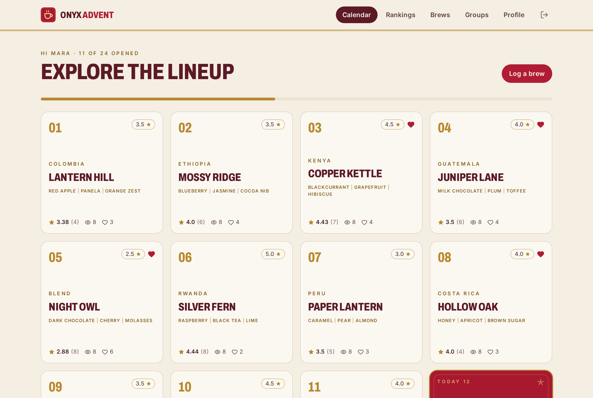
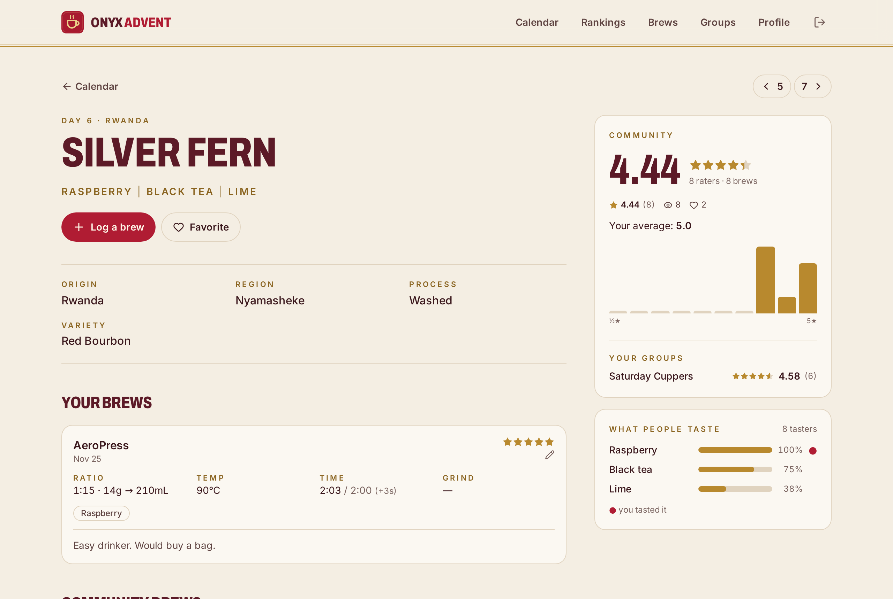
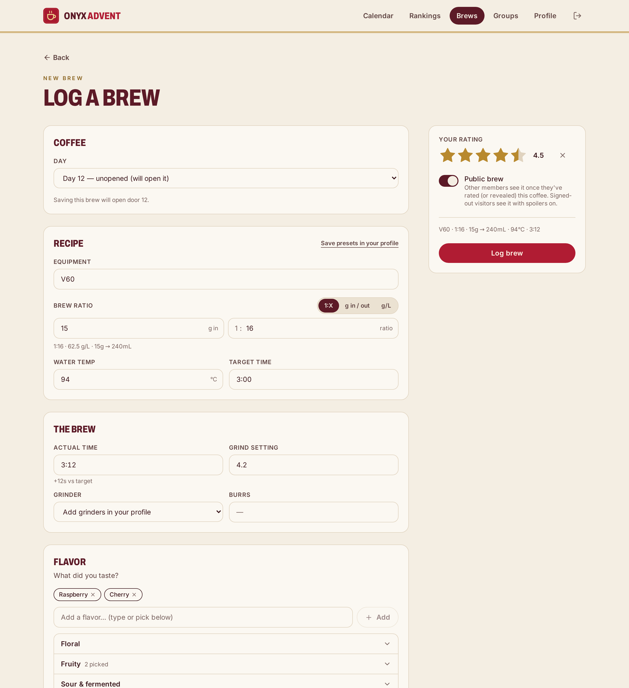
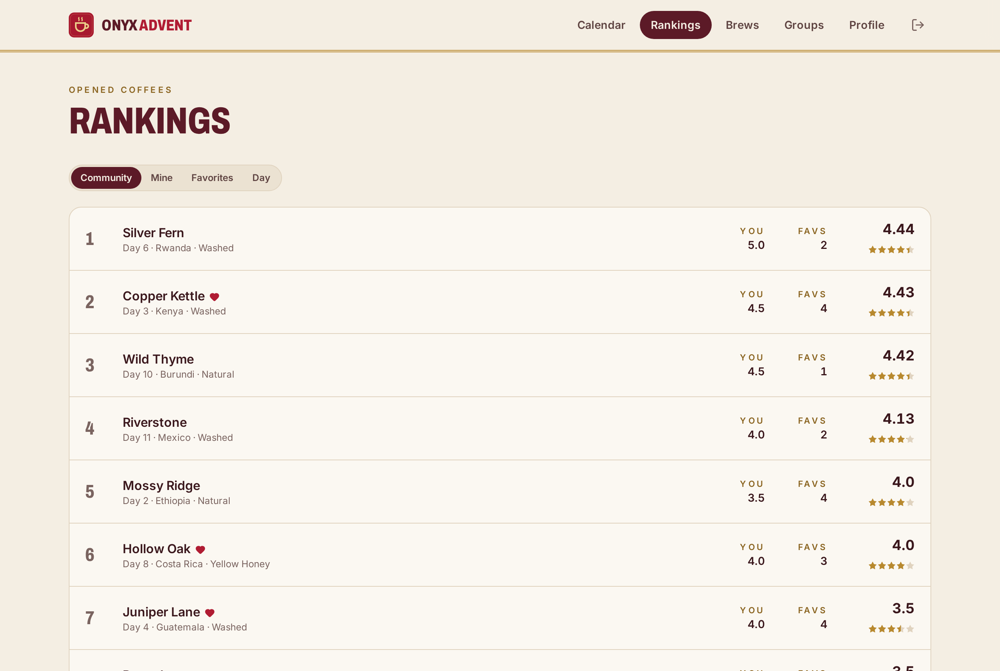
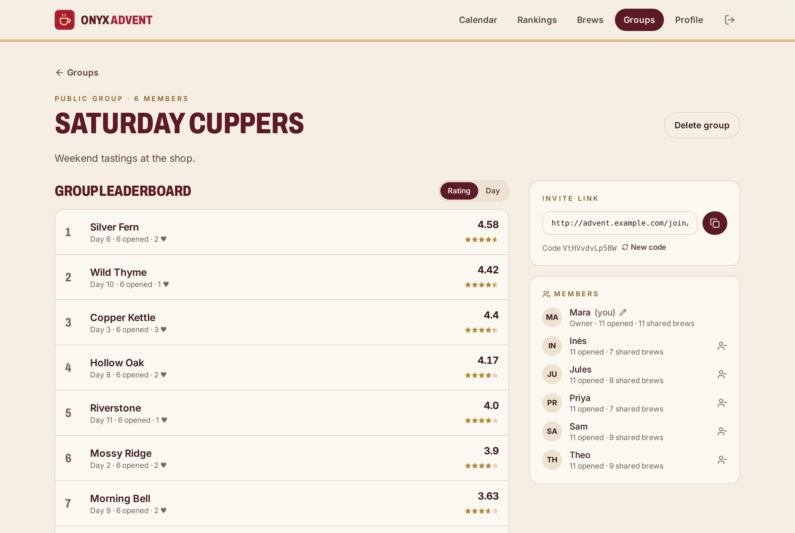
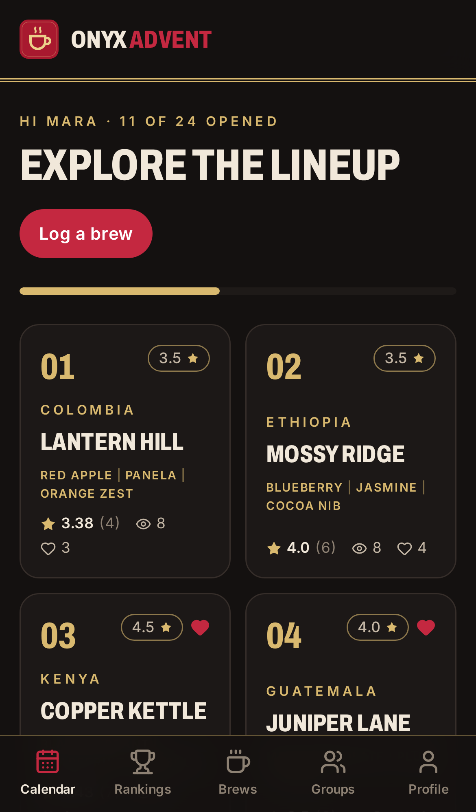

# 24 Cups

A place to compare notes on this year's coffee advent calendar. Open a door
each morning, log how you brewed it, rate it, and see what everyone else
thought.

24 Cups is an independent, community-run project. It is **not affiliated
with Onyx Coffee Lab or Fellow**.



## What you can do

**Open a door a day.** The calendar works like the real one: each coffee stays
hidden behind its door until you open it, and future days stay sealed. Signed
out, you can browse past days without an account.

**Taste blind if you want to.** After you open a door, the tasting notes,
community scores and other people's brews stay hidden until you've rated it
yourself, so your first sip isn't swayed by anyone else. Prefer to see
everything? Turn it off in your profile.



**Log your brews.** Record the method, dose and ratio, water temperature,
grinder and grind setting, how long it took, a half-star rating, and what you
tasted. Pick flavors from the coffee flavor wheel or type your own. Save your
usual recipes and grinders so logging takes seconds. Brews can be public or
private.



**See how everyone rates them.** Each coffee shows its community score, a
rating spread, and the flavors people pick out most often. Scores are
averaged per person first, so one enthusiastic brewer can't tip the
rankings. The Rankings page puts every coffee you've opened in order by the
community's average, yours, or favorites.



**Taste along with friends.** Make a group for your household, office or
coffee club. Groups can be public or invite-only, and each has its own
leaderboard and brew feed.



**Sign in with a passkey.** Use your phone's or laptop's fingerprint, face
or PIN instead of a password. The site only ever stores a public key, so
there's no password of yours to leak. Passwords still work if you prefer.

It works well on a phone, updates live as people post, and has a dark mode.



## A note on spoilers

The app only reveals coffees as their days come, but this repository has the
whole lineup in `data/coffees.json`. If you want to be surprised, don't open
that file. The screenshots above use made-up coffees.

## Running your own

It's a single Go binary with an embedded SQLite database, and it's happy on a
Raspberry Pi. The included Docker Compose setup puts it behind a Cloudflare
Tunnel with continuous backups to Cloudflare R2.

```sh
cp .env.example .env    # fill in your tunnel token, Turnstile and R2 keys
docker compose up -d --build
```

## Documentation

- [Deployment](docs/deployment.md): Cloudflare Tunnel, Turnstile, backups and restores
- [Configuration](docs/configuration.md): every setting, the lineup file, theming
- [Abuse protection](docs/abuse-protection.md): rate limits and Cloudflare settings
- [Observability](docs/observability.md): OpenTelemetry traces, metrics and logs
- [Performance](docs/performance.md): how it scales, and benchmarks
- [Development](docs/development.md): running locally, tests, and how the rules work

## License

MIT. See [LICENSE](LICENSE).
